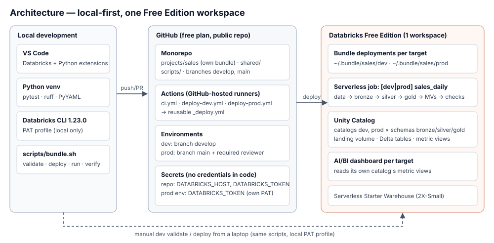

# Databricks CI/CD platform (PoC)

A local-first CI/CD proof of concept built on **Databricks Free Edition**, **Databricks
Asset Bundles** and **GitHub Actions**.

* Every project under `projects/` is an independent bundle, deployed separately.
* DEV and PROD share one workspace and are separated by Unity Catalog catalogs (`dev`,
  `prod`).
* Merging to `develop` deploys to DEV. Merging to `main` deploys to PROD after a manual
  approval.



*Code moves from a laptop to GitHub. GitHub Actions deploys and runs each bundle in the
Databricks workspace using a personal access token held in GitHub Secrets.*

## Documentation

New here? Start with **[How it works](docs/how-it-works.md)**, a plain-language tour of the
platform, `databricks.yml` and the bundle resources.

| Document | Read it for |
|---|---|
| [How it works](docs/how-it-works.md) | Beginner guide: the big picture, DEV vs PROD, what each bundle file does |
| [Architecture](docs/architecture.md) | Design decisions, Free Edition constraints, workspace layout, limitations |
| [Runbook](docs/runbook.md) | Local setup, deploy/run/verify, rollback, token rotation, troubleshooting |
| [GitHub setup](docs/github-setup.md) | One-time setup: secrets, environments, approval, branch rules |
| [KPI definitions](docs/kpi-definitions.md) | Formulas for net sales, SSSG, gross margin, sales/m², traffic, conversion, ATV, UPT, ASP, … |
| [Sales project](projects/sales/README.md) | What the `sales` bundle contains |

## Repository layout

```text
.github/workflows/    ci.yml · deploy-dev.yml · deploy-prod.yml · _deploy.yml (reusable)
projects/<project>/   one Databricks Asset Bundle per project (databricks.yml)
  resources/          job, landing volume, dashboard
  src/tables/         tables.yml registry + SQL SELECT files
  src/metric_views/   Unity Catalog metric views (KPI formulas)
  src/<package>/      project Python (data generator, KPI reference, checks)
  src/jobs/           entrypoint.py: the Python entry point for every job task
  dashboards/         AI/BI dashboard templates
  tests/              unit tests
shared/python/        platform_common: table builder, metric views, quality checks
scripts/              CI-agnostic tooling (bundle.sh, changed_projects.py, ...)
docs/                 documentation and SVG diagrams
```

## Quick start

```bash
python -m venv .venv
.venv/Scripts/python -m pip install -r requirements-dev.txt    # macOS/Linux: .venv/bin/python
.venv/Scripts/python -m pytest                                  # unit tests, no workspace needed

export DATABRICKS_CONFIG_PROFILE=free-edition                   # see docs/runbook.md
bash scripts/bundle.sh sales dev validate
bash scripts/bundle.sh sales dev deploy
bash scripts/bundle.sh sales dev run
bash scripts/bundle.sh sales dev verify
```

PROD is deployed by GitHub Actions only.
