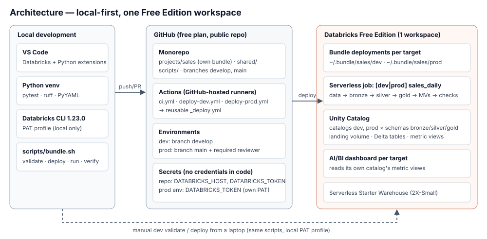
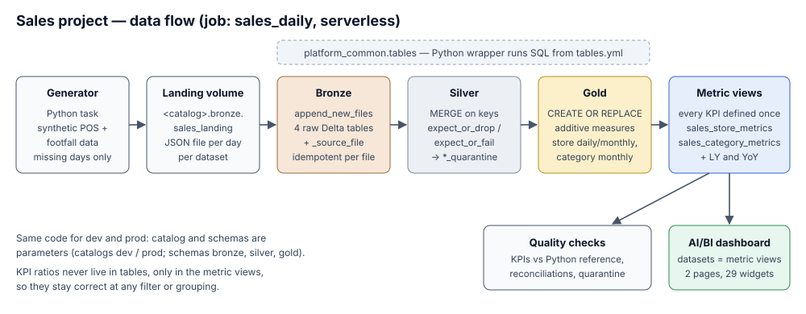
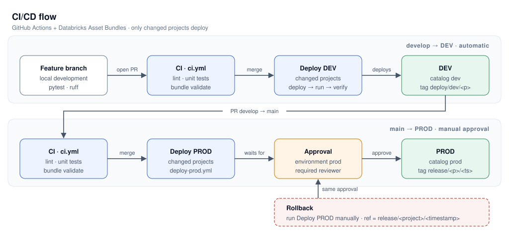

# Architecture and decisions

## Goals

A local-first CI/CD proof of concept on **Databricks Free Edition** with **GitHub Actions**:

* Each project is an independent Databricks Asset Bundle and deploys separately.
* DEV and PROD are separated by Unity Catalog catalogs inside a single workspace.
* Deployments are automatic to DEV and need manual approval for PROD.
* Rollback works per project.
* Everything runs from scripts, so a later GitLab CI migration only rewrites the
  pipeline YAML.

## Free Edition findings that shaped the design

| Constraint (Free Edition docs, Nov 2026) | Design response |
|---|---|
| Serverless compute only | All job tasks use serverless environments; there is no cluster config |
| 1 SQL warehouse, 2X-Small | Dashboards look up the "Serverless Starter Warehouse" by name; DEV and PROD share it |
| 5 concurrent job tasks per account | Job tasks run in sequence; CI deploys one project at a time (`max-parallel: 1`) |
| 1 active pipeline per type | Not applicable: there is no Lakeflow pipeline (plain Delta tables, see below) |
| No account console or account-level APIs | No account-level service principals and no GitHub OIDC federation, so CI uses **personal access tokens** |
| Daily fair-use compute quota | Small synthetic dataset; generation is incremental (missing days only) |
| Not for commercial use | PoC only, synthetic data only |

GitHub **free plan**: environment required reviewers only work in **public** repositories,
so the repo is public. Secrets live in GitHub Secrets, never in the code.

## Environments

| | DEV | PROD |
|---|---|---|
| Catalog | `dev` | `prod` |
| Schemas | `bronze`, `silver`, `gold` (shared by all projects) | same |
| Deployed by | `deploy-dev.yml` on merge to `develop` | `deploy-prod.yml` on merge to `main`, after approval |
| Bundle target | `dev` (schedule paused) | `prod` (`mode: production`, schedule active) |
| Workspace path | `/Users/<deployer>/.bundle/sales/dev` | `/Users/<deployer>/.bundle/sales/prod` |
| Credentials | repo secrets `DATABRICKS_HOST`, `DATABRICKS_TOKEN` | `prod` environment secret `DATABRICKS_TOKEN` (separate PAT) |

Schemas are created once by `scripts/bootstrap_uc.sql`, not by a bundle, so destroying one
project's bundle can never drop a schema another project uses.

## Data and transformation design

* **SQL holds the logic; a config-driven Python wrapper runs it.** Each table is a
  `SELECT` file plus an entry in `src/tables/tables.yml`: layer, write mode, keys and
  data-quality rules. `shared/python/platform_common/tables.py` executes the registry. It
  is shared by all projects, so adding a table never needs new Python.
* **Plain managed Delta tables.** There are no streaming tables and no Lakeflow pipeline.
  * Bronze loads only new landing files (`append_new_files`, idempotent per file).
  * Silver uses `MERGE` on business keys.
  * Gold uses `CREATE OR REPLACE`.
  * Materialized views weren't needed, because gold is small and fully rebuilt.
* **Data-quality rules.**
  * `expect` warns only.
  * `expect_or_drop` excludes bad rows; `<table>_quarantine` holds the latest rejects.
  * `expect_or_fail` stops the build.
* **Unity Catalog metric views are the semantic layer.** Gold tables contain only additive
  base measures. Every KPI formula, including prior year and YoY, is defined once in a
  metric view. Metric views aren't a bundle resource type yet, so the job task
  `publish_metric_views` creates them (`CREATE OR REPLACE VIEW … WITH METRICS`).
* **The AI/BI dashboard reads the metric views directly.** Metric-view datasets need fully
  qualified names, so the committed template uses `__CATALOG__` / `__GOLD_SCHEMA__` tokens.
  `scripts/render_dashboards.py` renders the template per target at deploy time.

## CI/CD design

* **Only affected projects deploy.**
  * Pull requests: CI validates projects changed relative to the base branch.
  * Deploys: each project is compared with its own tag, `deploy/<env>/<project>`, which
    moves only after a successful deploy. A cancelled or failed run therefore never hides
    a change.
  * Changes under `shared/` affect every project.
* **Each deploy is also the integration test.**
  1. `bundle validate`
  2. `bundle deploy`
  3. Run the project job: data → tables → metric views → quality checks.
  4. Execute every deployed dashboard widget query (`verify_dashboards.py`).
* **Rollback.** Every PROD deploy creates an immutable tag, `release/<project>/<UTC ts>`.
  Running *Deploy PROD* manually with that tag redeploys that project's code, job and
  dashboard, and the job re-publishes the older metric views. Data is not rolled back;
  Delta time travel is available if needed. The next merge to `main` that touches the
  project deploys `main` again, so follow a rollback with a revert commit.
* **Portable.** All logic lives in `scripts/`: `bundle.sh`, `changed_projects.py`,
  `install_databricks_cli.sh`, `verify_dashboards.py`, `mark_deployed.sh`. The workflows
  only call those scripts.

## Security notes

* There are no hosts, tokens or workspace IDs in the repo; a unit test fails on a
  committed PAT pattern.
* Fork PRs never receive secrets; bundle validation runs only for same-repo PRs.
* Local `prod` deploys are refused unless `ALLOW_LOCAL_PROD=1`.
  `bundle destroy` on prod is refused unless `ALLOW_PROD_DESTROY=1`.
* Deploys never auto-approve destructive changes, so CI stops for a human instead.
* The CLI is pinned (`.databricks-cli-version`) and its download is checked against the
  release SHA-256 sums.

## Limitations of this PoC

* **One identity.** Both PATs belong to the same user, so DEV and PROD are separated by
  catalog and process, not by permissions. On a paid workspace, use one service principal
  per environment with OAuth (or GitHub OIDC federation) and grant the DEV identity no
  access to `prod`.
* **One workspace and one warehouse.** DEV and PROD share compute and the daily quota.
* **Rollback covers code, not data.**
* **Dashboard edits made in the UI are not saved automatically.** Use
  `scripts/bundle.sh sales dev capture-dashboard sales_overview` to write them back into
  the template, then commit.

## Assumptions to confirm on the first DEV deploy

These follow the current docs but can only be proven against the workspace:

1. `sync.paths` with `../../shared/python` places files under
   `${workspace.file_path}/projects/sales/...` and `.../shared/python/...`
   (`entrypoint.py` searches both layouts and fails with a clear message otherwise).
2. The Free Edition warehouse is named **Serverless Starter Warehouse**.
3. Serverless `environment_version: "4"` is available.
4. Serverless job compute can run `CREATE VIEW … WITH METRICS` (it needs DBR 17.3+).
5. The dashboard JSON format for metric-view datasets (`asset_name`) and the widget specs
   (counter targets, tables, filters). `verify` checks that every widget query runs. If a
   visual setting is off, fix it in the UI and capture it back.
6. `mode: production` accepts a user `run_as` plus explicit permissions.
